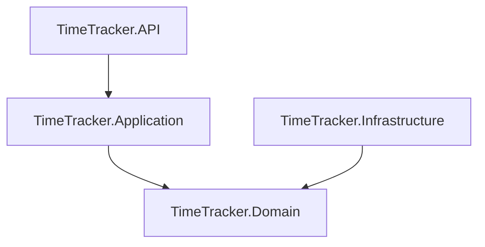

# Time Tracker

A small `.NET` project for tracking how time is actually spent during a workday — both by automatic capture (system events, focus changes) and manual logging.

## Why

Lost focus, procrastination, head-down deep-work — all of these are easier to notice when you can see them after the fact. The app exists to surface that information and, optionally, nudge gently (breaks, deadlines, recurring events).

- **Manual mode** — log activities by hand.
- **Automatic mode** — listen for system + user events and bucket them.

## Architecture

Domain-driven layout, four projects under one solution:

- **Domain** — entities (`User`, `TimeRecord`), invariants, business rules.
- **Application** — services and DTOs.
- **Infrastructure** — EF Core context, repositories, migrations.
- **API** — ASP.NET Core controllers.

## Documentation

- [Environment setup](md/environment/environment.md) — Hyper-V, Ubuntu VM, Docker, Portainer, MariaDB, HeidiSQL.
- [Development guide](md/development/development.md) — step-by-step build of the four projects.

## Stack

- `.NET 7+`
- EF Core with the [Pomelo MySQL provider](https://www.nuget.org/packages/Pomelo.EntityFrameworkCore.MySql)
- MariaDB in Docker (managed via Portainer)
- HeidiSQL as the desktop client

## License

The MySQL provider chain pulls in `MySql.Data`, which is [GPL-2.0-only](https://licenses.nuget.org/GPL-2.0-only). Mind that if you reuse code from this project.
