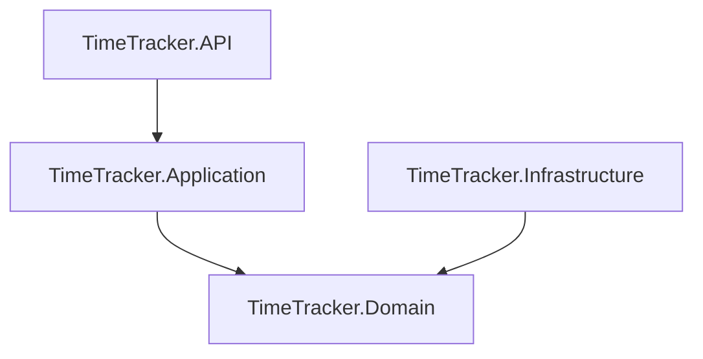

# Development guide

How the four `TimeTracker.*` projects fit together, and the order to build them in.

## Architecture

- API depends on Application.
- Application and Infrastructure both depend on Domain.
- Nothing depends on API or Infrastructure directly (those are the outer ring).

## Step 0 — System operation

A short technical description of how the system runs end-to-end:

1. The application launches (decision: long-running service vs. user-mode app).
2. It subscribes to relevant events — focus change, lock/unlock, user idle.
3. Each event is processed and recorded as a `TimeRecord` against the current `User`.

## Step 1 — Domain models

In `TimeTracker.Domain`:

- Define entities and aggregates: `TimeRecord`, `User`, …
- Encode the rules that should never be broken (invariants): a `TimeRecord` always has a non-null user, a duration ≥ 0, etc.

## Step 2 — Infrastructure

In `TimeTracker.Infrastructure`:

- Configure the EF Core `DbContext`.
- Implement the repository pattern for data access.
- Set up [migrations](setting-up-infrastructure/setting-up-infrastructure.md).

## Step 3 — Application logic

In `TimeTracker.Application`:

- Services that orchestrate the domain (e.g. `IRecordTimeUseCase`).
- DTOs used at the boundary.

## Step 4 — API

In `TimeTracker.API`:

- Controllers handling HTTP requests.
- Routing, request validation, response shaping.

## Step 5 — Tests, Docker, deploy

- **Integration tests** — exercise API + DB end-to-end.
- **Docker** — `Dockerfile` for the API; optional `docker-compose.yml` to bring up API + DB together.
- **Deployment** — pick a target (Azure App Service, a VPS, a self-hosted box) and deploy.

## Step 6 — Documentation

- Generate API docs with Swagger / OpenAPI.

## Maintenance

- **Update dependencies** — keep up with `.NET` LTS and EF Core releases. Currently on `.NET 7`; bumping to `.NET 8` mostly means updating package versions.
- **Code quality** — run analyzers, format with `dotnet format`, keep tests green.

## Reference

- [Solution & project setup commands](solution--project-setup-commands/solution--project-setup-commands.md) — `dotnet new` recipes for each project.
