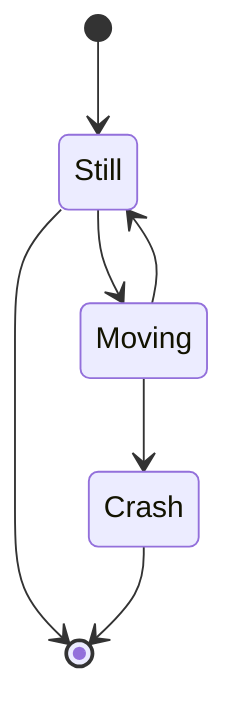
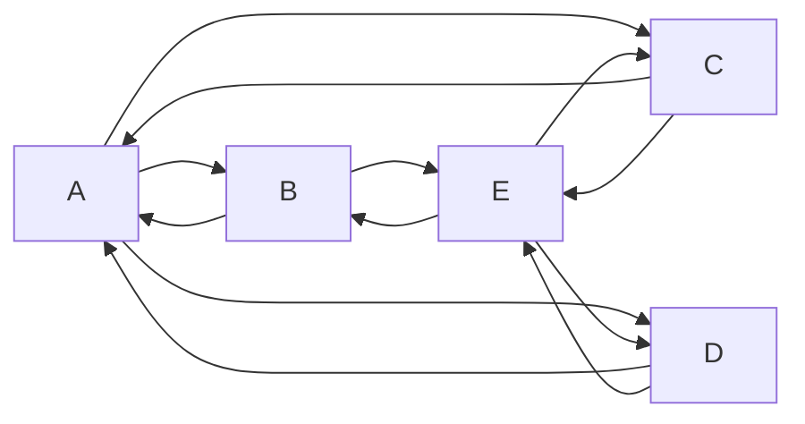
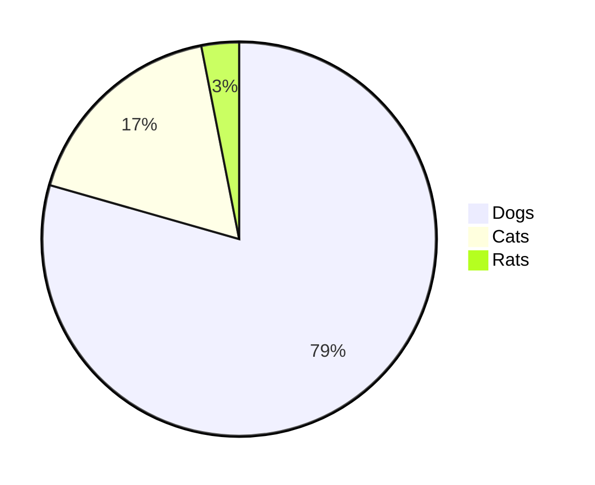

# Markdown playground

A scratch file for everything Markdown can render — KaTeX math, Mermaid diagrams, tables, embedded HTML, emoji shortcodes.

For a focused dive, see the sibling files:

- [`mermaid-examples.md`](mermaid-examples.md) — flowchart, sequence, gantt, state, class, pie, journey.
- [`plantuml-example.md`](plantuml-example.md) — minimal PlantUML.
- [`azure-mermaid-test.md`](azure-mermaid-test.md) — Azure DevOps' `::: mermaid` syntax.

## KaTeX math

Inline and block math with the [Markdown+Math](https://marketplace.visualstudio.com/items?itemName=goessner.mdmath) VS Code extension (or any KaTeX-aware renderer):

$$E = mc^2$$

$$x_{1,2} = \frac{-b \pm \sqrt{b^2 - 4ac}}{2a}$$

## Mermaid

A few quick samples — see [`mermaid-examples.md`](mermaid-examples.md) for the full menu.







## Code blocks

````markdown
```cs
using System.IO;

namespace CsvReaderApp
{
    class Program
    {
        static void Main()
        {
            var path = @"../../../data/data.csv";
            var lines = File.ReadAllLines(path);
            var cells = new CsvReader(new StringConverter()).Read<double>(lines);
        }
    }
}
```
````

````markdown
```json
{
  "firstName": "John",
  "lastName": "Smith",
  "age": 27
}
```
````

## Tables

| Right-aligned | Right-aligned | Right-aligned |
| ------------: | ------------: | ------------: |
|         00010 |        000011 |   00000000012 |

| Left-aligned | Right-aligned | Centered     |
| :----------- | ------------: | :----------: |
| 0000010      |     000000011 | 0000000000012 |

## Images

Reference image:


HTML for explicit sizing:

<p>
  
</p>

## Embedded HTML — collapsible block

<details>
  <summary>Click to expand</summary>

Anything in here is hidden until expanded — good for long examples or appendix notes.

</details>

## Emoji shortcodes

GitHub-flavoured Markdown supports a long list of emoji shortcodes:

`:white_check_mark:` `:x:` `:warning:` `:rocket:` `:tada:` `:sparkles:` `:heavy_check_mark:` `:link:` `:bangbang:` `:100:` — see [the full list](https://github.com/ikatyang/emoji-cheat-sheet).

## References

- [Markdown tutorial](https://www.w3schools.io/file/markdown-introduction/)
- [Azure DevOps Markdown guidance](https://docs.microsoft.com/en-us/azure/devops/project/wiki/markdown-guidance)
- [Mermaid documentation](https://mermaid-js.github.io/mermaid/#/)
- [VsixHub](https://www.vsixhub.com/) — community VSIX archive for VS Code extensions.
