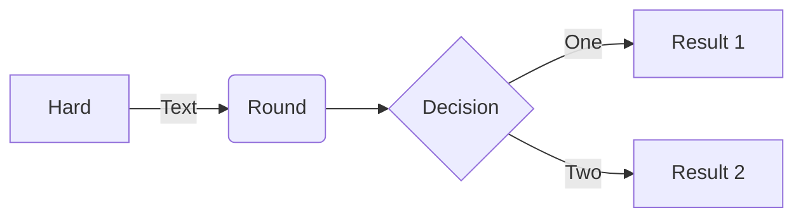
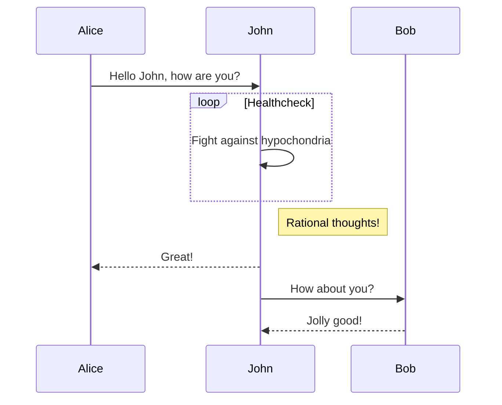
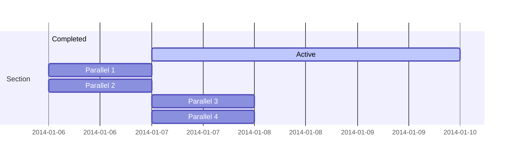
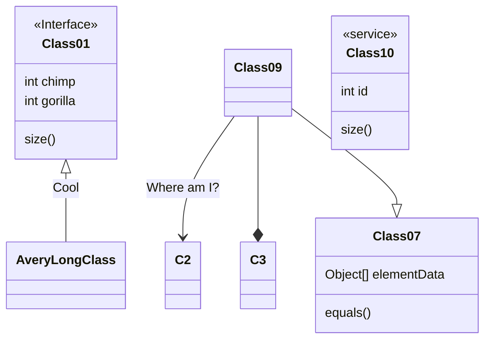
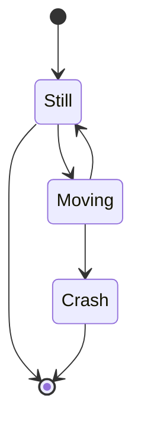
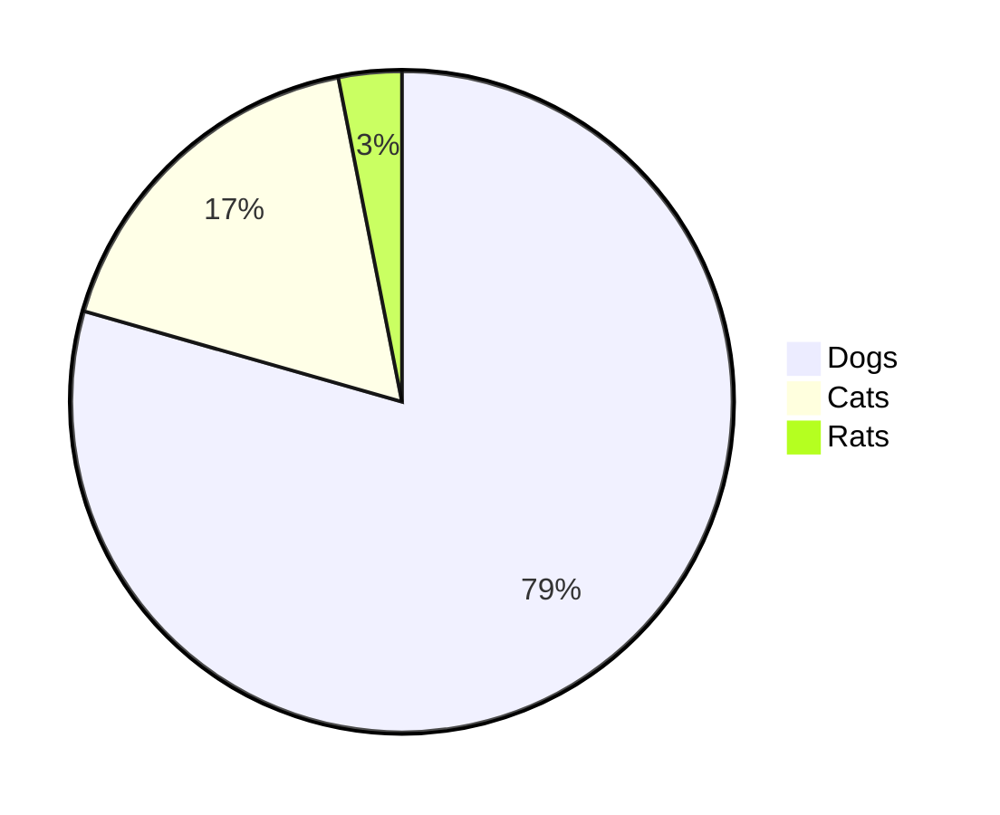
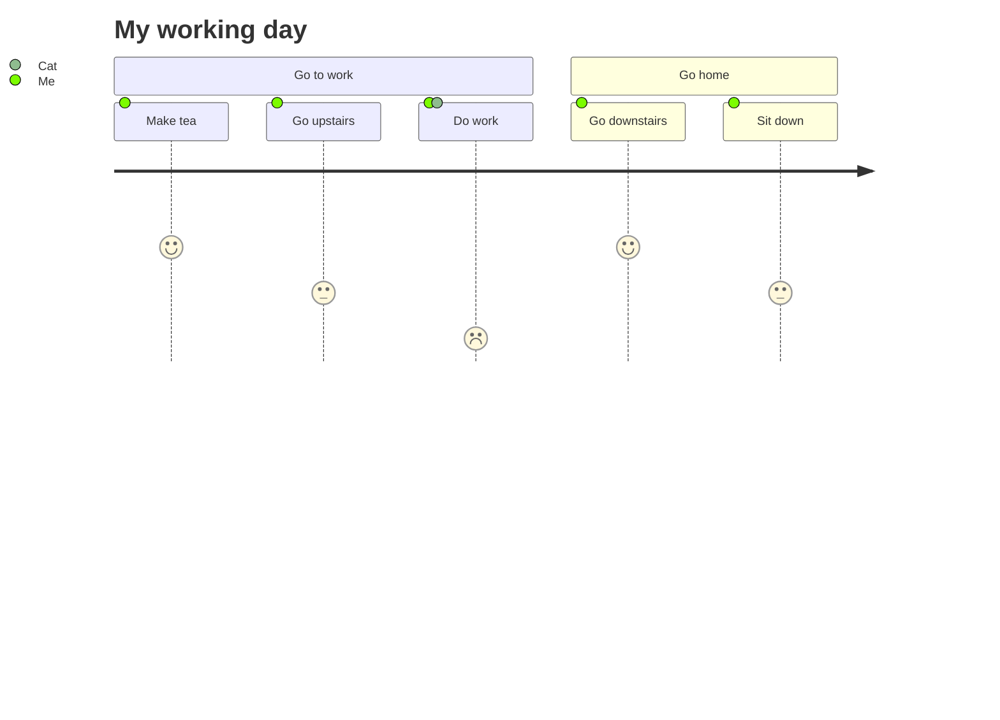
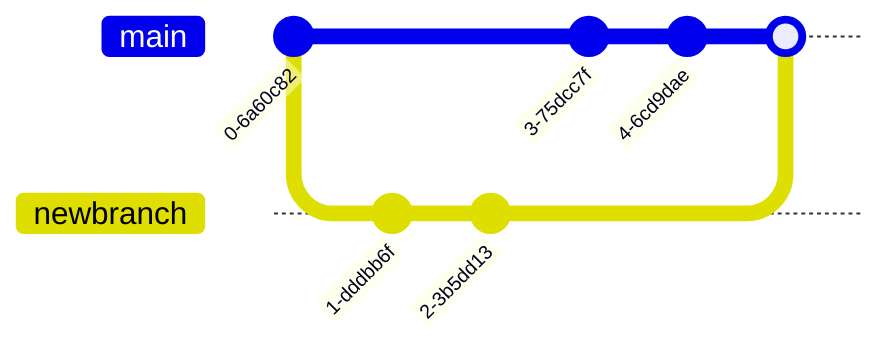

# Mermaid diagram catalogue

One example per diagram type, ready to copy. Each has a link to the [official docs](https://mermaid-js.github.io/mermaid/#/) and the [Mermaid live editor](https://mermaid.live/) where you can iterate visually.

## Flowchart

[Docs](https://mermaid-js.github.io/mermaid/#/flowchart) · [Live editor](https://mermaid.live/)

## Sequence diagram

[Docs](https://mermaid-js.github.io/mermaid/#/sequenceDiagram)

## Gantt chart

[Docs](https://mermaid-js.github.io/mermaid/#/gantt)

## Class diagram

[Docs](https://mermaid-js.github.io/mermaid/#/classDiagram)

## State diagram

[Docs](https://mermaid-js.github.io/mermaid/#/stateDiagram)

## Pie chart

[Docs](https://mermaid-js.github.io/mermaid/#/pie)

## User-journey diagram

[Docs](https://mermaid-js.github.io/mermaid/#/user-journey)

## Git graph (experimental)

