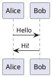

# PlantUML example

A minimal PlantUML sequence diagram. Render it with the [PlantUML server](https://www.plantuml.com/plantuml/uml/) or any IDE plugin (`@startuml` / `@enduml` markers are required).

